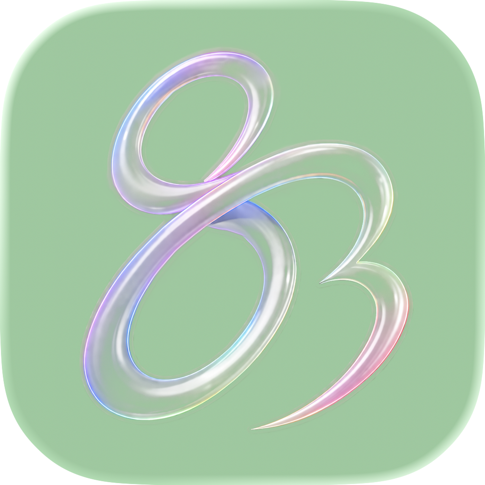
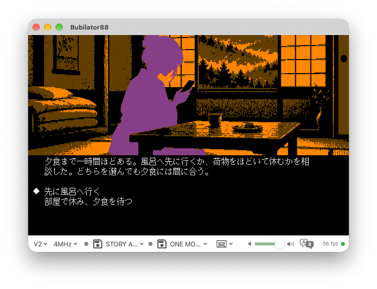

# Bubilator88

[日本語](README.md) | English

<p align="center">
  
</p>


NEC PC-8801 emulator for macOS</br>

https://bubio.github.io/Bubilator88/

[](https://github.com/bubio/Bubilator88/releases/latest)
[](https://github.com/bubio/Bubilator88/blob/main/LICENSE)
[](https://github.com/bubio/Bubilator88/releases/latest)
[](https://github.com/bubio/Bubilator88/actions/workflows/codeql.yml)

## About

Bubilator88 is a native macOS emulator of the NEC PC-8801 personal computer.

**Nearly all of the code in this project was written by AI (Claude, Codex).**

<p align="center">
  
</p>


A retro PC emulator is specialised software that demands deep expertise and careful implementation: reproducing undocumented hardware behaviour, T-state-accurate timing, and several LSIs working together. Bubilator88 grew out of one question: can AI build this kind of software from scratch?

It aims for a UI and features that feel at home on macOS.

There is also a Windows version.

https://github.com/bubio/Bubilator88/releases/tag/win-v1.2.0

## Features

- Z80 CPU emulation (T-state accurate)
- YM2608 (OPNA) sound — FM 6ch, SSG 3ch, Rhythm, ADPCM
- uPD765A FDC
- uPD3301 CRTC + DMA text display
- Fast screen rendering with Metal
- Low-latency sound output with AVAudioEngine
- Game controller support (with haptic feedback)
- Native on Apple Silicon

### Screen Filters

Several screen filters, implemented as Metal shaders.

- **Linear / Bicubic** — Smoothing with bilinear or bicubic interpolation
- **CRT** — CRT monitor scanlines and phosphor afterglow
- **xBRZ** — An edge-detecting scaler made for pixel art
- **Enhanced** — xBRZ combined with a filter of our own

### AI Upscale

Runs super-resolution models on CoreML to upscale the PC-8801 screen in real time. In practice it needs at least an M4 Pro.

### Immersive Audio

Spatial audio that follows head tracking on AirPods and similar headphones. The FM, SSG, Rhythm and ADPCM channels can each be placed anywhere in 3D space, and the sound changes as your head moves.

### Pseudo Stereo

Adds a slight delay difference between left and right to the mono sound output, giving it a stereo spread.

### Real-time Translation Overlay

Uses Apple Vision OCR and the Translation framework to recognise and translate Japanese text on the screen in real time, overlaid on the display.

### Haptic Feedback

Uses the vibration of game controllers, giving haptic feedback in step with SSG sound effects.

### Control Zones

Clicking a zone on the screen types the keys registered for it, so keyboard-only games can be played with a mouse or a game controller.

### Cheats

Supports 88PAR cheat codes (.pat), with a bundled code list covering 69 games.

### Text Copy & Paste

Copy the emulator's screen text to the macOS clipboard, or feed clipboard text in as simulated key presses. BASIC listings with half-width kana and sample code can be transcribed or pasted without typing them by hand.

## System Requirements

- macOS 26.0 (Tahoe) or later
- Apple Silicon Mac

## Install

### Homebrew

```bash
brew install --cask bubio/bubilator88/bubilator88
```

### Manual Download

Download the latest version from the [Releases](https://github.com/bubio/Bubilator88/releases) page.

> **Note**: The app is not notarized by Apple, so Gatekeeper may block it the first time you open it. Either of the following gets around this:
>
> **Option 1: Remove the quarantine flag in Terminal**
> ```bash
> xattr -cr /Applications/Bubilator88.app
> ```
>
> **Option 2: Allow it in System Settings**
> 1. Try to open the app and let it be blocked
> 2. Open System Settings → Privacy & Security
> 3. Click "Open Anyway" next to the message saying "Bubilator88" was blocked

## ROM Files

Booting a PC-8801 needs ROM files from real hardware (they are not included in this project). The rhythm WAV files are optional: without them, bundled substitute sounds play.

Place them in *~/Library/Application Support/Bubilator88/*.

```
~/Library/Application Support/Bubilator88/
├── N88.ROM          N88-BASIC ROM (required)
├── N80.ROM          N-BASIC ROM
├── FONT.ROM         Font ROM
├── KANJI1.ROM       Kanji ROM (level 1)
├── KANJI2.ROM       Kanji ROM (level 2)
├── JISYO.ROM        Dictionary ROM (kana-kanji conversion)
├── DISK.ROM         Sub CPU firmware (8KB)
├── N88_0.ROM        N88 extension ROM bank 0
├── N88_1.ROM        N88 extension ROM bank 1
├── N88_2.ROM        N88 extension ROM bank 2
├── N88_3.ROM        N88 extension ROM bank 3
├── 2608_BD.WAV      YM2608 rhythm (bass drum) *optional; bundled substitute otherwise
├── 2608_SD.WAV      YM2608 rhythm (snare)
├── 2608_TOP.WAV     YM2608 rhythm (cymbal)
├── 2608_HH.WAV      YM2608 rhythm (hi-hat)
├── 2608_TOM.WAV     YM2608 rhythm (tom)
└── 2608_RIM.WAV     YM2608 rhythm (rim shot)
```

### Without Real ROMs: pbios (Substitute BIOS)

Place `n88.rom` and `disk.rom` from cisc's boot-only substitute BIOS
[pbios](http://retropc.net/cisc/m88/download.html) as `N88.ROM` and `DISK.ROM`,
and some software that does not use BASIC boots.

## Development

The emulation core is a Swift package in a separate repository,
[Bubilator88Core](https://github.com/bubio/Bubilator88Core).
Opening `Bubilator88.xcodeproj` fetches the pinned version of the core and builds.

To edit the core as well, clone it next to this repository and open
`Bubilator88Dev.xcworkspace`. The local core then takes precedence over the remote one.

```bash
git clone https://github.com/bubio/Bubilator88.git
git clone https://github.com/bubio/Bubilator88Core.git
open Bubilator88/Bubilator88Dev.xcworkspace
```

It also builds from the command line with CMake (3.21 or later).
Run from the repository root, this is a Debug build with exclusivity checking, using the local core.

```sh
cmake --preset dev
cmake --build --preset dev
```

For switching Release between checked and unchecked, and for shell scripts that need no CMake,
see the [local build instructions](docs/LOCAL_BUILD.md) (in Japanese).

Internal design documents are in a private submodule (`docs/develop`). They are not needed to
build or run, and are for contributors with access.

```bash
git submodule update --init docs/develop
```

## Credits

- **FM synthesis**: [fmgen](http://retropc.net/cisc/sound/) by cisc — ported to Swift
  (for its terms see `Sources/FMSynthesis/fmgen-readme.txt` in
  [Bubilator88Core](https://github.com/bubio/Bubilator88Core); the changes are in `fmgen-changes.md` in the same directory)
- **Reference emulator**: [QUASI88](https://www.eonet.ne.jp/~showtime/quasi88/) by S.Fukunaga — consulted as the behavioural reference
- **Reference emulator**: [common source code project](https://takeda-toshiya.my.coocan.jp/common/index.html) by Takeda Toshiya — consulted as BubiC-8801MA
- **Reference emulator**: [X88000](https://quagma.sakura.ne.jp/manuke/x88000.html) by Manuke — reference for undocumented Z80 instructions and implementation details
- **Technical documentation**: [PC-8801についてのページ](http://www.maroon.dti.ne.jp/youkan/pc88/) by youkan — hardware specification reference
- **Technical documentation**: [PC-8801 VRAM情報](http://mydocuments.g2.xrea.com/html/p8/vraminfo.html) — VRAM access specification reference
- **Scaling algorithm**: [xBRZ](https://sourceforge.net/projects/xbrz/) by Zenju — basis of the Enhanced filter
- **AI model**: [Real-ESRGAN](https://github.com/xinntao/Real-ESRGAN) — CoreML model for super-resolution upscaling
- **AI coding**: [Claude Code](https://claude.ai/code) (Anthropic) — generated nearly all of the code

## License

[GNU General Public License v2.0](LICENSE)
